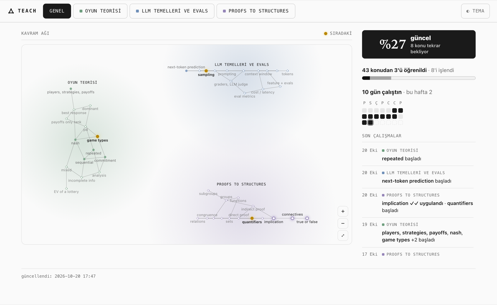
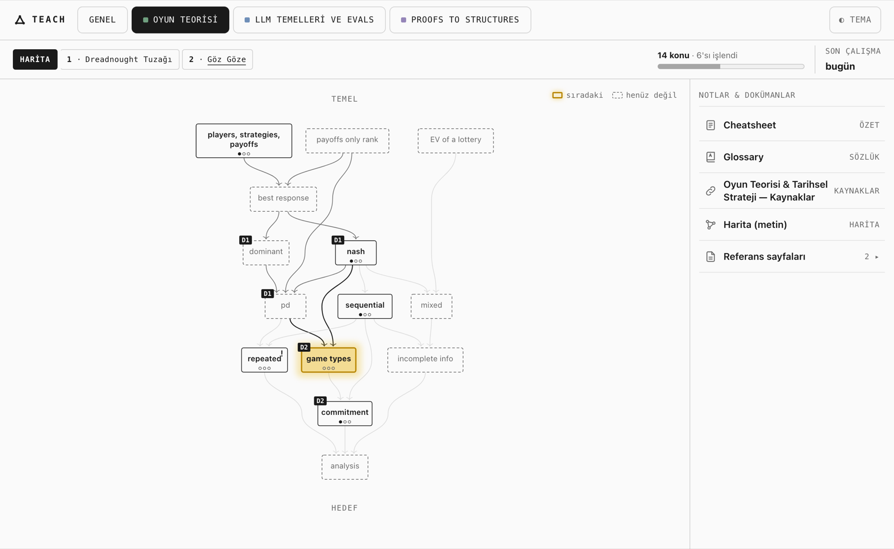

<h1 align="center">teach</h1>

Claude Code içinde çalışan kişisel öğretmen. Ne öğrenmek istediğini söylersin; sana özel bir yol çizer ve adım adım öğretir.

## Nasıl çalışır

- **Önce hedefini sorar.** Birkaç soruyla asıl amacını bulur ve sana uygun dersi önerir.
- **Ezberletmez, anlatır.** Temelden başlar, her seferinde tek adım ilerler ve sık sık soru sorar. Cevaplarından seni tanır.
- **Unutturmaz.** Tekrar zamanı gelen konuları kısa ısınmalarla geri getirir.
- **İlerlemeni gösterir.** Haritan, notların ve derslerin tek bir panoda durur.

## Kurulum

1. [VS Code](https://code.visualstudio.com/) ve **Claude Code** eklentisini kur. Claude Code için ücretli bir Claude planı gerekir. Windows'ta [Git](https://git-scm.com/download/win) de kur.
2. Bu repoyu indir: `git clone https://github.com/GDenizKaratas/teach-yourself-ai.git`
3. Klasörü VS Code'da aç. Claude panelinde yeni bir sohbet başlatıp **"başla"** yaz.

Python kurulumu dahil gerisini ilk sohbette birlikte yaparsınız. Adım adım kontrol listesi: [KURULUM.md](KURULUM.md).

## Bilmen gerekenler

- Verilerin yalnızca senin bilgisayarında, `learner/` ve `tracks/` klasörlerinde durur. Git'e gönderilmez.
- Panoyu açmak için: `learner/dashboard.html`. Bir kez yer imine eklersen tek tıkla açılır.
- Bırakmak için "bugünlük bu kadar" yazman yeterli. Bir sonraki sefer kaldığın yerden devam eder.

Başka bir yapay zekâ ajanıyla kullanmak için: [AGENTS.md](AGENTS.md). Sistemin nasıl kurulduğu: [docs/engine.md](docs/engine.md).

MIT lisansı: [LICENSE](LICENSE).
