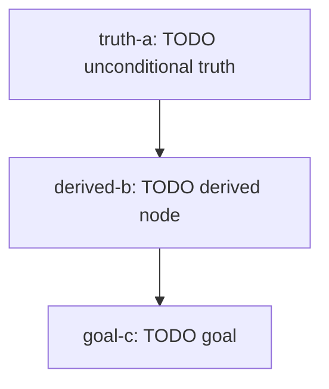

# Dependency map — {{TITLE}}

<!-- map-format: 1 -->
Roots are unconditional truths; arrows point from a node to what is built on it; the goal is the sink.

## Nodes

| id | kind | statement (one line) | tanım (öğrenci) | depends on | mastery evidence |
|---|---|---|---|---|---|
| truth-a | truth | TODO | TODO | – | e.g. predict-output card + task 01 |
| derived-b | derived | TODO | TODO | truth-a | |
| goal-c | goal | TODO | TODO | derived-b | |

Node status is computed by `tools/learn progress`. Don't track it here.

<!--
Format (read by `tools/learn map --track <t>`; `validate` checks it; keep the map-format marker line above):
- Node ids are slugs: lowercase letters, digits and '-' (e.g. best-response). Cards' and tasks' `node` use these ids.
- Mermaid block: `graph TD`, one edge per line `from --> to` (chains `a --> b --> c` are fine).
  A node may carry a label once: id["id: short label"]. Every node appears in at least one line.
- Node table: the first table whose first column header is `id`, in teaching order (progress lists nodes in
  this order). Columns: id | kind (truth|derived|goal) | statement (one line) | tanım (öğrenci) | depends on |
  mastery evidence. "tanım (öğrenci)" is the node's definition for the learner: one or two plain sentences in the
  learner's language, terms as they were taught; the dashboard's node card shows it as "Tanım" (falls back to
  the statement when empty).
  "depends on" is a comma-separated list of ids, or – for roots; it must match the graph's arrows into the node.
- The table ids and the mermaid ids are the same set; the graph is acyclic.
- Other tables (e.g. notes carried over from elsewhere) may follow; their first column must not be `id`.
-->
